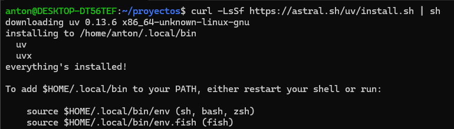
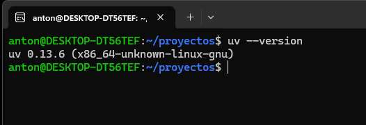
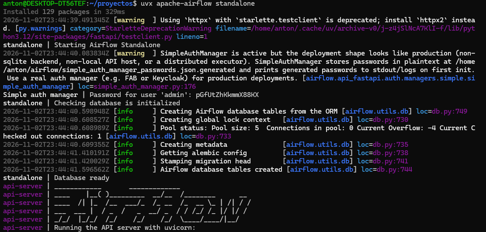
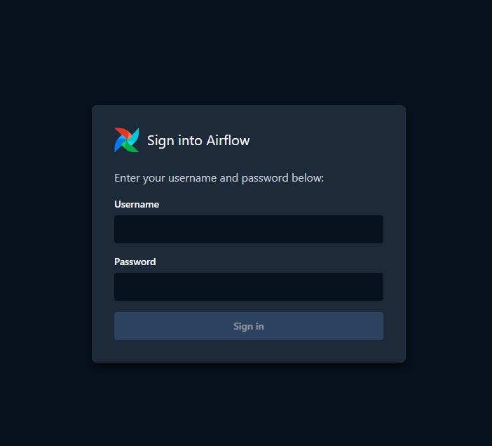
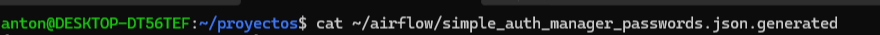
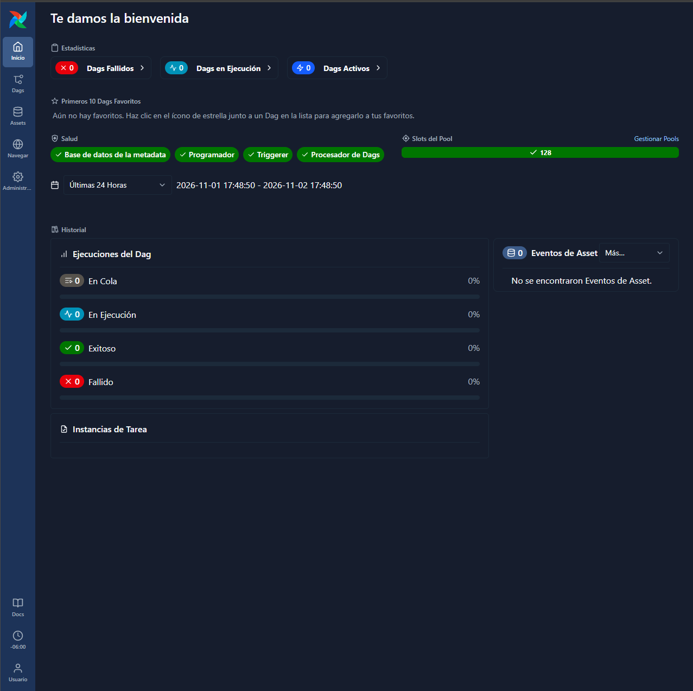
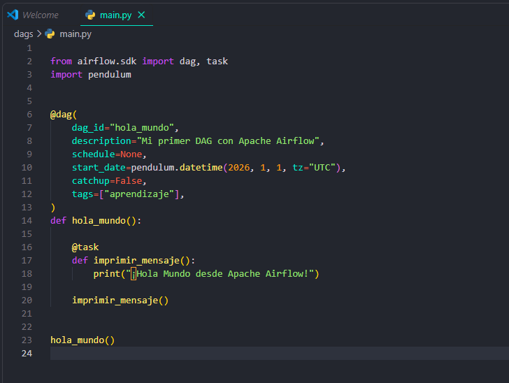
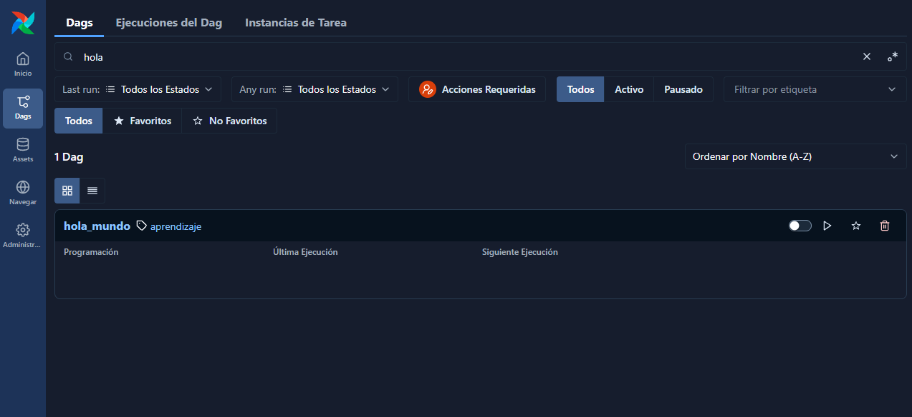
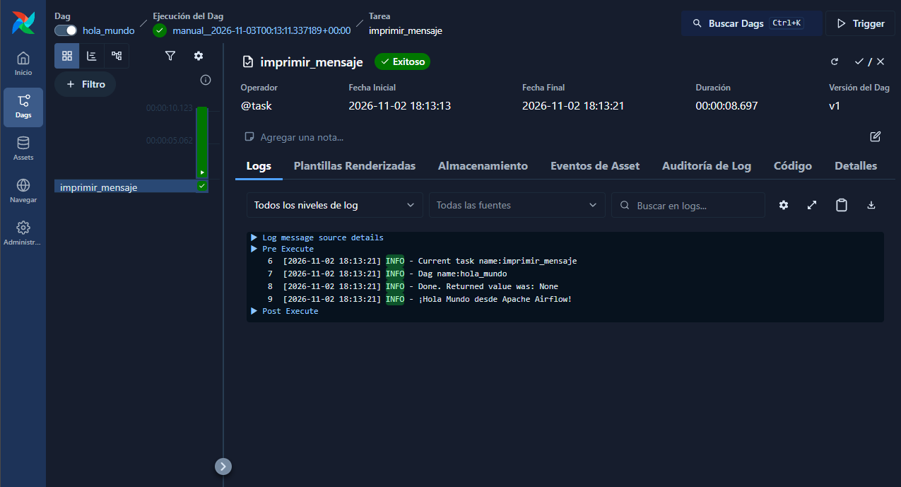

# Práctica: Introducción a Apache Airflow

## Introducción

Para esta práctica utilizaremos **Apache Airflow**, una herramienta de código abierto enfocada en la orquestación de workflows (flujos de trabajo). Para esta primera actividad opté por realizar un ejercicio sencillo: crear y ejecutar mi primer «Hola Mundo» utilizando esta plataforma.

Aunque Apache Airflow comparte ciertas similitudes con herramientas como **n8n**, ambas tienen propósitos y enfoques diferentes. Airflow está especialmente orientado a la programación, ejecución y supervisión de flujos de trabajo mediante código.

## 1. Instalación de Apache Airflow desde cero

Existen diferentes formas de comenzar a utilizar Apache Airflow. Entre las opciones más comunes se encuentran:

- **Modo Standalone:** permite ejecutar los componentes necesarios de Airflow en un solo entorno local. Es una alternativa sencilla para comenzar a experimentar con la herramienta.
- **Docker Compose:** permite levantar los diferentes componentes de Airflow mediante contenedores independientes. Es una buena alternativa para conocer cómo se despliega y organiza la plataforma en un entorno basado en Docker.

En mi caso, utilizaré el **modo Standalone**, ya que es mi primer acercamiento a Apache Airflow. De esta manera, evitamos configurar y levantar múltiples contenedores en nuestra máquina local.

### Paso 1. Instalar uv

`uv` es un gestor de paquetes y entornos de Python. Lo utilizaremos para ejecutar Apache Airflow y administrar sus dependencias sin modificar directamente la instalación global de Python.

Desde la terminal ejecutamos el siguiente comando:

```bash
curl -LsSf https://astral.sh/uv/install.sh | sh
```



Una vez finalizada la instalación, comprobamos que se haya instalado correctamente utilizando el siguiente comando:

```bash
uv --version
```



### Paso 2. Ejecutar Apache Airflow

Para iniciar Apache Airflow en modo Standalone, ejecutamos el siguiente comando:

```bash
uvx apache-airflow standalone
```



Este comando descargará las dependencias necesarias, inicializará la base de datos local y levantará los componentes requeridos para ejecutar Airflow.

Una vez finalizado el proceso de inicialización, podremos acceder a la interfaz web desde nuestro navegador utilizando la siguiente dirección:

```text
http://localhost:8080
```



Airflow genera automáticamente un usuario con el nombre **admin** y una contraseña para acceder a la plataforma. Podemos consultar dicha contraseña desde otra terminal utilizando el siguiente comando:

```bash
cat ~/airflow/simple_auth_manager_passwords.json.generated
```



Con estas credenciales podremos iniciar sesión en la plataforma y acceder a su interfaz de administración.



## 2. Crear nuestro primer DAG: Hola Mundo

Una vez que tenemos Apache Airflow funcionando correctamente, comenzaremos creando nuestro primer workflow.

Al iniciar Airflow, se genera un directorio de trabajo llamado `airflow` dentro de nuestro directorio personal. En él encontraremos diferentes archivos y carpetas necesarios para el funcionamiento de la plataforma.

Su estructura principal es similar a la siguiente:

```text
~/airflow/
├── dags/
├── logs/
├── plugins/
├── airflow.cfg
├── airflow.db
└── simple_auth_manager_passwords.json.generated
```

La carpeta que nos interesa es **`dags/`**, ya que es donde almacenaremos nuestros propios workflows para que Airflow pueda detectarlos y administrarlos.

### Paso 1. Crear el archivo Python

Dentro de la carpeta `dags/` crearemos un archivo Python con el nombre que prefiramos. En mi caso, lo nombré `main.py`.



Dentro de este archivo definiremos nuestro primer DAG, encargado de ejecutar una tarea que imprimirá el mensaje «¡Hola Mundo desde Apache Airflow!».

A continuación, se explican los principales elementos utilizados en su estructura:

- **`@dag`:** indica que estamos definiendo un DAG (Directed Acyclic Graph), es decir, un flujo de trabajo.
- **`dag_id`:** establece el identificador único de nuestro DAG, mediante el cual podremos localizarlo dentro de la interfaz de Airflow.
- **`schedule=None`:** indica que el DAG no tendrá una programación automática y que deberá ejecutarse manualmente.
- **`start_date`:** establece la fecha a partir de la cual el DAG puede comenzar a ejecutarse.
- **`catchup=False`:** evita que Airflow intente ejecutar automáticamente las ejecuciones pendientes de periodos anteriores.
- **`@task`:** convierte una función de Python en una tarea que será administrada por Airflow.
- **`print()`:** imprime el mensaje que queremos mostrar. Este podrá consultarse posteriormente en los registros (logs) de ejecución de la tarea.

Una diferencia importante respecto a ejecutar un script convencional de Python es que Airflow interpreta la estructura del DAG y se encarga de administrar la ejecución de sus tareas, así como sus dependencias y registros.

### Paso 2. Ejecutar el DAG desde la interfaz web

Una vez guardado nuestro archivo Python, regresamos a la interfaz web de Apache Airflow.

Es importante recordar que debemos buscar nuestro workflow utilizando el identificador definido en `dag_id`, en este caso, **`hola_mundo`**, y no el nombre del archivo `main.py`.

A continuación, realizamos los siguientes pasos:



1. Buscar el DAG llamado `hola_mundo`.
2. Activarlo en caso de que aparezca pausado.
3. Presionar el botón de ejecución (*Trigger DAG*) para iniciar el workflow.
4. Ingresar al DAG y abrir la vista **Grid**, donde podremos visualizar el estado de sus ejecuciones.
5. Seleccionar la tarea `imprimir_mensaje`.
6. Acceder a la sección **Logs** para consultar el resultado de su ejecución.

Si todo se ejecutó correctamente, encontraremos en los registros el siguiente mensaje:

```text
¡Hola Mundo desde Apache Airflow!
```



## Conclusión

Con esta práctica realicé mi primer acercamiento a Apache Airflow, desde su instalación y configuración inicial hasta la creación y ejecución de un DAG sencillo.

Además, pude familiarizarme con algunos de sus conceptos fundamentales, como los DAG, las tareas y los registros de ejecución.

Aunque el ejercicio fue básico, permitió comprender cómo funciona la plataforma y cómo podemos utilizarla para organizar y automatizar diferentes procesos mediante código Python.

De esta manera, finalizo mi primera práctica utilizando Apache Airflow.